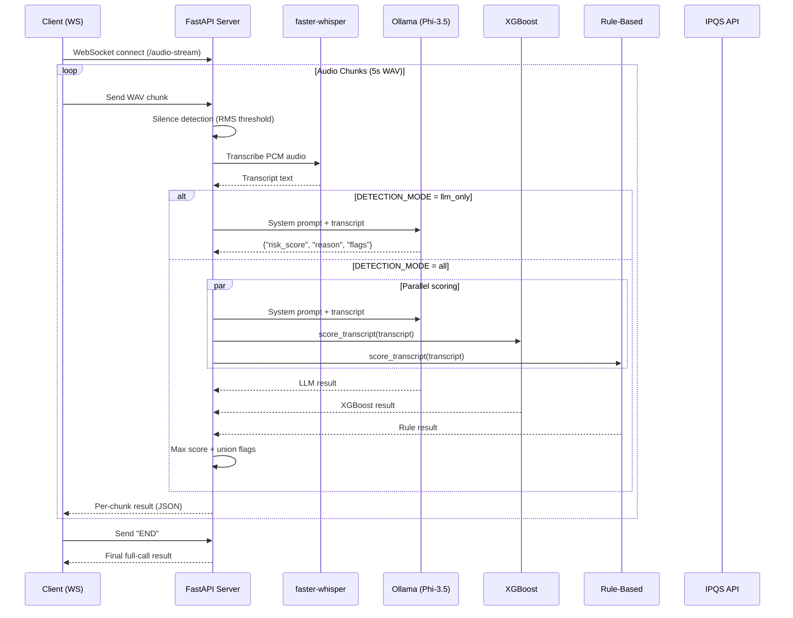
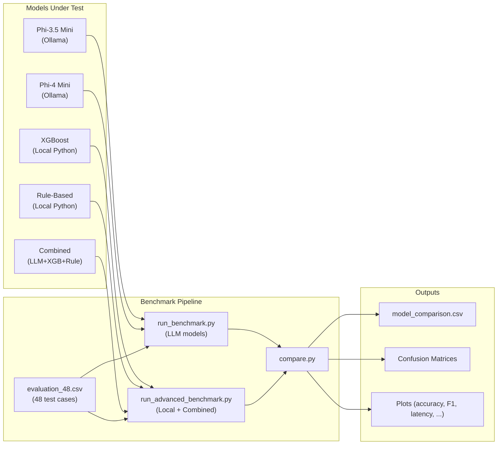

# System Architecture

## Full System Architecture

```mermaid
graph TB
    subgraph Input["Data Input Layer"]
        Mic["Microphone / Audio Stream"]
        SMS["SMS Messages"]
        Phone["Phone Numbers"]
    end

    subgraph Clients["Client Layer"]
        WSClient["WebSocket Client<br/>(test_client.py)"]
        Android["Android App<br/>(Kotlin/Gradle)"]
    end

    subgraph Servers["Server Layer — FastAPI + WebSockets"]
        MainServ["Main Server<br/>server.py"]
        OsintServ["OSINT Server<br/>New version - OSINT"]
        XGBServ["XGBoost + Rule Server<br/>New version - XGBOOST - RULE"]
    end

    subgraph STT["Speech-to-Text Engine"]
        Whisper["faster-whisper<br/>(Base Model, CUDA float16)"]
    end

    subgraph Detection["Detection Engines"]
        LLM["LLM Engine<br/>Ollama + Phi-3.5"]
        XGB["XGBoost Engine<br/>model.json + features.py"]
        Rule["Rule-Based Engine<br/>rulebased/engine.py"]
        IPQS["IPQS Lookup<br/>ipqs/lookup.py"]
    end

    subgraph Scoring["Scoring Modes — DETECTION_MODE"]
        LLMOnly["llm_only"]
        XGBOnly["xgboost_only"]
        RuleOnly["rulebased_only"]
        All["all — Combined<br/>(Max Score + Union Flags)"]
    end

    subgraph Benchmark["Benchmark System"]
        RunBench["run_benchmark.py<br/>(LLM models)"]
        AdvBench["run_advanced_benchmark.py<br/>(Local + Combined)"]
        Compare["compare.py<br/>(Metrics + Plots)"]
    end

    subgraph Datasets["Datasets & Prompts"]
        Eval["evaluation_48.csv<br/>(48 test cases)"]
        Prompt["ca_scam_system_prompt.txt"]
    end

    subgraph Finetune["Fine-Tuning Pipeline"]
        FT["finetune/<br/>(LoRA / QLoRA training)"]
    end

    subgraph Results["Results & Outputs"]
        Runs["benchmark/runs/<br/>(raw_results.csv, metadata.json)"]
        Metrics["benchmark/results/<br/>(model_comparison.csv)"]
        Plots["benchmark/results/plots/<br/>(PNG visualizations)"]
        ConfMat["confusion_matrices/"]
    end

    %% Client → Server connections
    Mic --> WSClient
    SMS --> WSClient
    Mic --> Android
    SMS --> Android
    Phone --> Android
    WSClient -->|WebSocket /audio-stream| MainServ
    WSClient -->|WebSocket /audio-stream| OsintServ
    WSClient -->|WebSocket /audio-stream| XGBServ
    Android -->|WebSocket /audio-stream| XGBServ

    %% Server → STT
    MainServ --> Whisper
    OsintServ --> Whisper
    XGBServ --> Whisper

    %% Main Server detection
    MainServ --> LLM

    %% OSINT Server detection
    OsintServ --> LLM
    OsintServ --> IPQS

    %% XGBoost+Rule Server detection
    XGBServ --> LLM
    XGBServ --> XGB
    XGBServ --> Rule

    %% Detection modes
    LLM --> LLMOnly
    XGB --> XGBOnly
    Rule --> RuleOnly
    LLM --> All
    XGB --> All
    Rule --> All

    %% Benchmark connections
    RunBench -->|tests via Ollama API| LLM
    AdvBench -->|imports directly| XGB
    AdvBench -->|imports directly| Rule
    AdvBench -->|tests via Ollama API| LLM
    Compare --> Runs
    Compare --> Metrics
    Compare --> Plots
    Compare --> ConfMat

    %% Dataset connections
    RunBench --> Eval
    RunBench --> Prompt
    AdvBench --> Eval
    AdvBench --> Prompt
    FT --> Eval

    %% Styles
    style LLM fill:#4C72B0,color:#fff
    style XGB fill:#DD8452,color:#fff
    style Rule fill:#55A868,color:#fff
    style IPQS fill:#C44E52,color:#fff
    style Whisper fill:#8172B3,color:#fff
    style All fill:#937860,color:#fff
```

## Data Flow — Single Request Lifecycle

## Benchmark Pipeline

## Component Inventory

| Component | Technology | Purpose |
|-----------|-----------|---------|
| WebSocket Server | FastAPI + WebSockets | Real-time audio/SMS streaming |
| Speech-to-Text | faster-whisper (Base, CUDA) | Audio → Transcript |
| LLM Scoring | Ollama + Phi-3.5 | Transcript → Risk Score |
| XGBoost Scoring | xgboost (model.json) | Transcript → Risk Score |
| Rule-Based Scoring | Pure Python regex engine | Transcript → Risk Score |
| OSINT Lookup | IPQualityScore API | Phone → Reputation Score |
| Android Client | Kotlin + Gradle + WebSockets | Mobile audio/SMS capture |
| Benchmark | Python (requests, csv, json) | Automated evaluation |
| Visualization | matplotlib | Comparison plots |
| Fine-Tuning | LoRA / QLoRA | Model adaptation |
